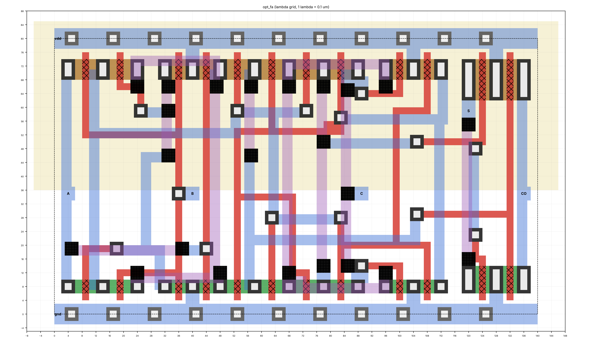

# Design and Performance Analysis of a Full-Custom ALU Using Optimized Standard Cells

Full-custom design of a 4-bit bit-sliced ALU in 180 nm CMOS, built from a custom
standard-cell library whose cells are optimized for minimum power-delay product.
The design is compared after layout with a conventional static-CMOS implementation
and with an automated standard-cell implementation of the same ALU. (The project
started as an 8-bit ALU; it was reduced to 4 bits after the review of 31 October 2026.)

## Technology and tools

| Item | Choice |
| --- | --- |
| Process | TSMC 0.18 um CMOS, VDD = 1.8 V |
| Device models | MOSIS BSIM3v3.1 parameters, lot T14B (`models/tsmc018_t14b.lib`) |
| Layout rules | MOSIS SCMOS SCN6M_SUBM, lambda = 0.1 um (OSU018 kit in Qflow) |
| Layout, DRC, extraction | Magic 8.3 |
| LVS | Netgen |
| Simulation | Ngspice 46 (circuits), iverilog (logic) |
| Automated implementation | Yosys, Qflow, OpenSTA with the OSU 0.18 um standard cells |

All tools run in the NIELIT ChipCraft Virtual Lab; the OSU018 kit is read from
`/apps/vlsi/share/qflow/tech/osu018`.

Current progress and the plan are in [STATUS.md](STATUS.md).



## Repository layout

| Path | Contents |
| --- | --- |
| `models/` | Transistor models (`nfet`, `pfet`) |
| `tech/magicrc` | Magic start-up file that loads the SCN6M_SUBM.10 rules |
| `rtl/`, `tb/` | 4-bit ALU in Verilog (behavioural `alu4.v`, bit-sliced `alu4_slice.v`) and the exhaustive testbench |
| `sim/alutb.py` | Transistor-level ALU testbench used for every design (Ngspice) |
| `layout/` | Cell layout generator: Magic writer, cell plans, placer and router, rule checker, extractor |
| `mag/` | Generated Magic layouts |
| `step1_flowcheck/` | End-to-end flow check on one inverter |
| `step2_rtl_baseline/` | Automated implementation D3: RTL and gate-level tests, Yosys, OpenSTA, Qflow, DRC, extraction, post-layout simulation |
| `step3_cells/` | Candidate cell circuits (XOR2, MUX2, FA, gates), their Ngspice comparison and sizing sweep |
| `step4_layout/` | Layouts of the optimized and conventional libraries: Magic DRC, Netgen LVS, post-layout simulation |
| `docs/figures/` | Layout views for the report and slides |

## ALU

Eight operations selected by `s[2:0]`: ADD, SUB, INC, DEC (000-011) and AND, OR, XOR,
NOT (100-111), with carry C (1 = no borrow for SUB and DEC), signed overflow V, zero Z
and negative N. The bit-sliced description follows the full-custom structure: per bit,
operand conditioning `bx = s1 ? s0 : (b ^ s0)`, a full adder, the logic unit, and a
4:1 and a 2:1 output multiplexer; the carry-in `s1 ^ s0` selects between ADD, SUB,
INC and DEC. Both descriptions are verified exhaustively (2048 vectors) against
integer arithmetic in `tb/tb_alu4.v`.

## Automated implementation (Step 2, design D3)

Both RTL descriptions are taken through the complete automated flow:
Yosys synthesis onto the OSU018 cells, exhaustive gate-level simulation, OpenSTA,
Qflow placement and routing with cell-level LVS, a Magic design-rule check with the
real cell layouts (GDS view, not the LEF outlines), and a flat transistor-level
extraction of the routed layout with all parasitic capacitances. The extracted
netlist and the cell-level netlist before layout are then simulated with the
ALU testbench below, so the automated design is measured exactly like the
full-custom ones.

## ALU-level measurement (`sim/alutb.py`)

* Inputs are driven through two X1 inverters from ideal sources with 50 ps edges;
  every output drives four X1 inverters (fan-out of four).
* The stimulus contains every full-length carry propagation of ADD, SUB, INC and
  DEC started at bit 0 (a0, b0) or at the operation select (s0, s1), in both
  directions (18 transitions for 4 bits), followed by 24 random operand changes for
  each of the eight operations; 5 ns per vector.
* The delay of a transition runs from the input of the last driver inverter of the
  latest changing input to the last 50 % crossing of any output in that cycle, so
  glitches count; it is also reported from the ALU input pins.
* The energy of a transition is the charge drawn from the ALU supply in that cycle
  times VDD; the energy of the input drivers is reported separately. Energy per
  operation is the mean over the random transitions of that operation.
* Output levels are checked at the end of every cycle (logic value and swing within
  10 % of the rails). Leakage is the mean of 16 DC operating points.
* The netlist may be a Magic extraction (flat or hierarchical) or a cell-level netlist
  with its cell library: the top subcircuit is unwrapped, bus names are converted,
  and supply, substrate and well nodes are joined to the measured supplies.

## Cell template

Row height 8.0 um (80 lambda), rails 0.6 um wide on metal1 and shared between
mirrored rows, NMOS on the ground side and PMOS in a full-width n-well on the
supply side, substrate and well taps under the rails. Drawn channel length is
0.2 um (2 lambda), the SCMOS SUBM minimum. Transistors up to 2.4 um (NMOS) and
3.2 um (PMOS) fit in one finger; wider ones are folded.

## Cell characterization (Step 3)

Every candidate cell is driven through two X1 inverters and loaded with four X1
inverters (FO4). The input sequence is an Eulerian circuit over all input states,
so every input transition occurs once. The worst delay over all transitions is
measured from the input of the last driver inverter, so the load a cell places on
its driver counts; power includes the drivers. Each candidate is simulated at 8
width scales (k = 0.3 to 2) and 5 P/N ratios (r = 1 to 3); the size with minimum
power-delay product, full output swing and correct logic is selected.

## Cell layout generation (Step 4)

The cells are laid out by `layout/cellgen.py` from their transistor netlists:

* Placement: a column plan per cell (`layout/library.py`) orders the transistors
  of both rows along shared diffusion (Euler paths); strips with transistors wider
  than the row are folded into two or three mirrored copies.
* Routing: a maze router on the lambda grid (polysilicon, metal1, metal2, poly
  contacts and vias) with negotiated congestion: all nets are routed, nets that
  violate spacing are rerouted with rising penalties until none remain. Gaps
  narrower than the spacing rule between parts of one net are filled.
* Pins: every input and output gets a 4 x 4 lambda metal1 pad with free metal2
  above, so the ALU-level router can land a via on it.
* Checks before a cell is written: a rule checker covering the SCN6M_SUBM rules
  of the layers used, with Magic's edge and corner semantics (`layout/drc.py`),
  and an extractor that compares the drawn devices and nets with the netlist
  (`layout/extract.py`). Magic DRC and Netgen LVS in the lab remain the sign-off.

Layouts are regenerated with `python3 step4_layout/gen_cells.py --preview`
(needs numpy and matplotlib, run outside the lab); the lab only verifies them.

## Running the steps (in ChipCraft)

```
git clone https://github.com/manshukgarg/alu-fullcustom-180nm.git
cd alu-fullcustom-180nm
bash step1_flowcheck/run.sh        # inverter flow check
bash step2_rtl_baseline/run.sh     # automated implementation D3, both RTL styles (10-20 min)
bash step3_cells/run.sh            # candidate cells at reference size
bash step3_cells/run_sweep.sh      # sizing sweep, selects the optimized library
bash step4_layout/run.sh           # DRC, LVS and post-layout simulation of both libraries
```

Each script prints a one-screen summary and writes it to `out/summary.txt` in its
directory; Step 2 also writes `out/step2_results.json` and, per simulated netlist,
`out/sim/<label>.json` and `out/sim/<label>_transitions.csv`.

Viewing the layouts:

```
cd step4_layout && magic -rcfile ../tech/magicrc ../mag/opt_fa.mag      # a library cell
cd step2_rtl_baseline/qflow_slice/layout && magic alu4                   # routed ALU (Qflow .magicrc)
klayout step2_rtl_baseline/qflow_slice/layout/alu4_full.gds              # routed ALU with cell layouts
```

## Status

| Step | Content | Result |
| --- | --- | --- |
| 1 | Inverter flow check | DRC clean, LVS match, post-layout delay +6.9 % over schematic |
| 2 | Automated implementation D3 | 8-bit version (30 Oct): 524,288 vectors pass, 136 cells, 4090 um2, 1.59 ns, DRC and LVS clean; 4-bit flow with post-layout ALU simulation ready for the lab |
| 3 | Cell topology comparison and sizing | TG styles lowest PDP; sizing sweep rerun pending |
| 4 | Layouts of both libraries | 13 of 14 cells generated (conventional full adder outstanding), rule check and connectivity clean; lab verification pending |
