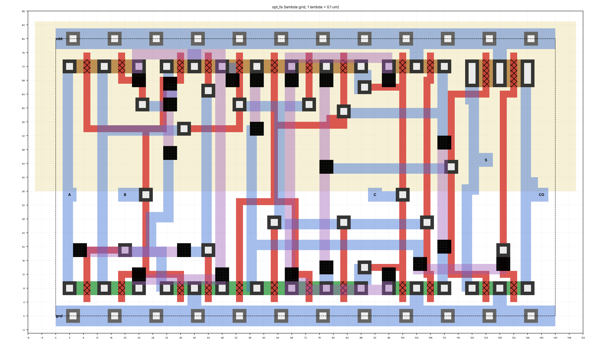
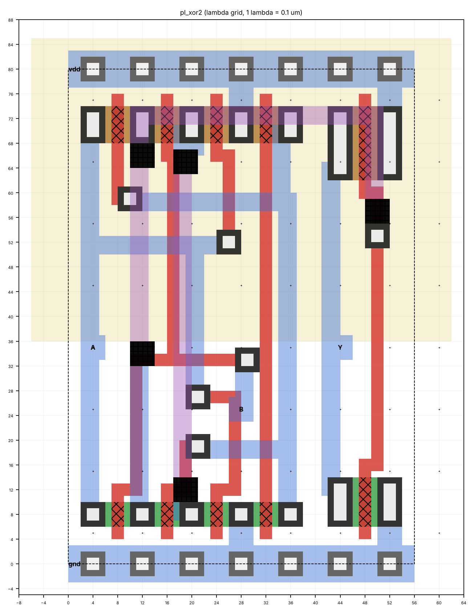
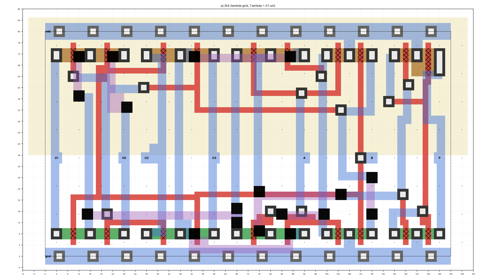

# Design and Performance Analysis of a Full-Custom ALU Using Optimized Standard Cells

Design of a 4-bit bit-sliced ALU in 180 nm CMOS from a custom standard-cell library
whose cells are optimized for minimum power-delay product, and of two cells made for
this ALU (a function block and a carry-sum cell) that together form one ALU bit with
44 transistors. The ALU built from them is compared with the same ALU built from
conventional static-CMOS cells, from the optimized cells in the conventional slice,
and with automated standard-cell implementations: one with the OSU 0.18 um cells and
one with the project's own cell library. (The project started as an 8-bit ALU; it
was reduced to 4 bits after the review of 31 October 2026.)

Result before layout (Ngspice 46, 1.8 V, 27 C, same test for every design): the
proposed ALU has 272 transistors against 578 for the conventional design, with 30 %
less worst-case delay, 75 % less energy per operation and 76 % less leakage.

## Technology and tools

| Item | Choice |
| --- | --- |
| Process | TSMC 0.18 um CMOS, VDD = 1.8 V |
| Device models | MOSIS BSIM3v3.1 parameters, lot T14B (`models/tsmc018_t14b.lib`) |
| Layout rules | MOSIS SCMOS SCN6M_SUBM, lambda = 0.1 um (OSU018 kit in Qflow) |
| Layout, DRC, extraction | Magic 8.3 |
| LVS | Netgen |
| Simulation | Ngspice 46 (circuits), iverilog (logic); LTspice decks for the cell designers |
| Automated implementation | Yosys, Qflow, OpenSTA with the OSU 0.18 um standard cells |

All tools run in the NIELIT ChipCraft Virtual Lab; the OSU018 kit is read from
`/apps/vlsi/share/qflow/tech/osu018`.

Current progress and the plan are in [STATUS.md](STATUS.md).



## Repository layout

| Path | Contents |
| --- | --- |
| `models/` | Transistor models (`nfet`, `pfet`) |
| `tech/magicrc` | Magic start-up file that loads the SCN6M_SUBM.10 rules |
| `rtl/`, `tb/` | 4-bit ALU in Verilog (behavioural `alu4.v`, bit-sliced `alu4_slice.v`, hand-mapped `alu4_map_*.v`) and the exhaustive testbench |
| `sim/alutb.py` | Transistor-level ALU testbench used for every design (Ngspice) |
| `sim/gen_alu.py` | Generator of the structural ALU from a cell set (SPICE and Verilog), with exhaustive checks |
| `sim/switchsim.py` | Switch-level logic check of transistor netlists (no simulator needed) |
| `sim/cellbench.py` | Cell measurement from the waveforms, for cells with many inputs |
| `sim/make_ltspice_package.py` | Writes and checks `ltspice_package/`: cells, ALUs and test decks that run in LTspice |
| `ltspice_package/` | The package handed to the LTspice designers (models, cell files, ALU netlists, 53 decks, expected results, guide) |
| `results/` | Stored results of the simulation steps |
| `docs/alu_cells.md` | The two ALU-specific cells: function, circuits, sizing, comparison, layout, prior art |
| `layout/` | Cell layout generator: Magic writer, cell plans, placer and router, rule checker, extractor |
| `mag/` | Generated Magic layouts |
| `step1_flowcheck/` | End-to-end flow check on one inverter |
| `step2_rtl_baseline/` | Automated implementation D3: netlist and gate-level tests, Yosys, OpenSTA, Qflow, DRC, extraction, post-layout simulation |
| `step6_alu_schematic/` | The ALU at transistor level from each cell style (before layout) and its comparison |
| `step5_library/` | Project cell library pl018 (generator, characterization) and the automated implementation D4 with it |
| `tech/pl018/` | Qflow technology of the project library: LEF, Liberty (written in the lab), SPICE, Verilog, setup files |
| `docs/ltspice_cells.md` | Conventions for cells designed in LTspice |
| `step3_cells/` | Candidate cell circuits (XOR2, MUX2, FA, gates) and the two ALU-specific cells, their switch-level check, Ngspice comparison and sizing sweeps |
| `step4_layout/` | Layouts of the optimized and conventional libraries: Magic DRC, Netgen LVS, post-layout simulation |
| `docs/figures/` | Layout views for the report and slides |

## ALU

Eight operations selected by `s[2:0]`: ADD, SUB, INC, DEC (000-011) and AND, OR, XOR,
NOT (100-111), with carry C (1 = no borrow for SUB and DEC), signed overflow V, zero Z
and negative N. The bit-sliced description follows the full-custom structure: per bit,
operand conditioning `bx = s1 ? s0 : (b ^ s0)`, a full adder, the logic unit, and a
4:1 and a 2:1 output multiplexer; the carry-in `s1 ^ s0` selects between ADD, SUB,
INC and DEC. Both descriptions are verified exhaustively (2048 vectors) against
integer arithmetic in `tb/tb_alu4.v`.

## Automated implementation (Step 2, design D3)

Three descriptions of the ALU are taken through the complete automated flow: the
behavioural RTL (`beh`), the bit-sliced RTL (`slice`) and a hand-mapped netlist (`map`).
Logic synthesis maps only single-output cells, so the synthesized designs cannot use
the library's full adder; the hand-mapped netlist does. It also uses inverting
multiplexers throughout: each multiplexer receives its inputs in the complemented
polarity (NAND and NOR in place of AND and OR, XNOR in place of XOR, the complemented
sum), so no multiplexer needs an output inverter. The netlist is written by
`sim/gen_alu.py` for the OSU018 cells (`rtl/alu4_map_osu018.v`) and for the project
library (`rtl/alu4_map_pl018.v`) and checked against the reference model on all 2048
input vectors. The flow is
Yosys synthesis onto the OSU018 cells, exhaustive gate-level simulation, OpenSTA,
Qflow placement and routing with cell-level LVS, a Magic design-rule check with the
real cell layouts (GDS view, not the LEF outlines), and a flat transistor-level
extraction of the routed layout with all parasitic capacitances. The extracted
netlist and the cell-level netlist before layout are then simulated with the
ALU testbench below, so the automated design is measured exactly like the
full-custom ones.

## Project cell library and design D4 (Step 5)

The cells that the automated flow may use must restore their outputs, because the
synthesis tool connects them freely; the unbuffered pass-gate cells of Step 3
(`xor_tg8`, `mux_tg6`, `fa_tga20`) are therefore reserved for the full-custom slice,
and the library pl018 takes the minimum-PDP restoring candidate of every function:

| Function | Cell | Structure |
| --- | --- | --- |
| INV, NAND2, NOR2 | `pl_inv`, `pl_nand2`, `pl_nor2` | static CMOS |
| AND2, OR2 | `pl_and2`, `pl_or2` | NAND2 or NOR2 with an output inverter |
| XOR2 | `pl_xor2` | transmission gates + output inverter |
| MUX2 | `pl_mux2` | transmission gates + two inverters |
| MUX2I | `pl_mux2i` | transmission gates + output inverter |
| FA | `pl_fa` | transmission-gate adder, buffered outputs |
| FB4 | `pl_fb4` | function block: tree of six transmission gates, restored output (ALU-specific) |
| CS | `pl_cs` | carry multiplexer and sum/result selection with transmission gates, restored outputs (ALU-specific) |
| BUF | `pl_buf` | two inverters (X1, X2), output buffering by Qflow |
| fill | `pl_fill` | rails and well only |

The cells are laid out by the project generator in grid mode: the width is a whole
number of 0.8 um sites on an 8.0 um row, and every pin pad is centred on a crossing
of the OSU018 routing tracks (metal2 every 0.8 um, metal1 every 1.0 um), which holds
for every placement orientation. The LEF uses the OSU018 technology section; a pin is
the complete metal of its net, and internal nets are obstructions. In the lab, every
cell is checked (Magic DRC, Netgen LVS) and characterized with Ngspice from its
extracted layout into a 5 x 5 NLDM Liberty file (delay and transition against output
load and input transition, input capacitance, leakage), in the conventions of the
OSU018 library. The same three descriptions then go through the same flow as D3, and
the summary compares D4 with D3 after layout. A fourth design, `fb`, is the proposed
function-block ALU as a hand-mapped netlist (`rtl/alu4_fb_pl018.v`, 27 cells).



## ALU-specific cells (Step 3c)

Two cells were designed for the bit slice of this ALU (`docs/alu_cells.md`):

* FB4 (20 transistors): P = C0, C1, C2 or C3 for (A, B) = 00, 01, 10, 11. Four code
  lines, common to all bits and set by a small decoder from the operation select, make
  P any function of the operand bits: the propagate signal for ADD, SUB, INC and DEC,
  the result for AND, OR, XOR and NOT.
* CS (24 transistors): CO = CI if P = 1, else A; Y = P if K = 1, else P xor CI. When
  the propagate signal is 0 the carry out equals the operand bit, so no generate
  signal is needed; K = s2 selects the logic result or the sum.

Both are transmission-gate circuits with restored outputs, so they are ordinary
library cells. They are sized like every other cell (minimum PDP at FO4) and laid
out by the cell generator as `pl_fb4` and `pl_cs`. The function block follows the
OM-2 data path of Mead and Conway (1980) and the carry multiplexer the carry logic
of FPGA logic cells; the project's part is their combination into two restoring
standard cells, their sizing and layout, and the measured comparison.



## The ALU from each cell set (Step 6)

`sim/gen_alu.py` composes the 4-bit ALU from five cell sets and writes one
transistor-level netlist each (`step6_alu_schematic/netlists/`). Results of
`sim/alutb.py` before layout (229 transitions, all correct in every design):

| Netlist | Cells | Transistors | Worst delay (ps) | Energy per operation (fJ) | Leakage (nW) |
| --- | --- | --- | --- | --- | --- |
| `alu4_gate.sp` | gate-level cells: XOR from four NAND2, multiplexer from AND/OR gates, full adder from eleven NAND2 (k = 0.4, r = 2) | 842 | 2925.4 | 2039.6 | 1.41 |
| `alu4_conv.sp` | conventional static CMOS: 12-transistor XOR and multiplexer, 28-transistor mirror adder (k = 1, r = 2) | 578 | 2979.6 | 3509.8 | 2.02 |
| `alu4_opt.sp` | minimum-PDP cells of Step 3, unbuffered transmission-gate cells included | 402 | 2267.5 | 1102.1 | 0.81 |
| `alu4_pl.sp` | cells of the library pl018 as laid out, slice with inverting multiplexers | 458 | 2310.7 | 1312.8 | 0.93 |
| `alu4_fb.sp` | proposed: one FB4 and one CS cell per bit, pl018 cells for decoder and flags | 272 | 2076.2 | 870.6 | 0.47 |

The first three use the slice of `rtl/alu4_slice.v`, the fourth the hand-mapped
netlist of design D4, the fifth the function-block slice. The select lines are
buffered inside each ALU. Every netlist is read back and evaluated at switch level
(`sim/switchsim.py`: an NMOS conducts when its gate is 1, a PMOS when it is 0, all
2048 vectors at once) and must reproduce the reference model before it is committed.

## LTspice package

`sim/make_ltspice_package.py` writes `ltspice_package/`: the model file with
LEVEL = 8 (BSIM3v3 in LTspice and Ngspice), the five cell sets, the five ALUs, a test
deck for each of the 38 cells and three decks per ALU (32-vector function test with
the results as decimal words, the slowest transition, energy per operation), the
expected values and a guide. The decks contain only statements common to LTspice and
Ngspice; the script runs every deck with Ngspice and compares its measurements with
the project flow. The decks have not been run in LTspice.

## ALU-level measurement (`sim/alutb.py`)

* Inputs are driven through two X1 inverters from ideal sources with 50 ps edges;
  every output drives four X1 inverters (fan-out of four).
* The stimulus contains every full-length carry propagation of ADD, SUB, INC and
  DEC started at bit 0 (a0, b0) or at the operation select (s0, s1), in both
  directions (18 transitions for 4 bits), followed by 24 random operand changes for
  each of the eight operations; 5 ns per vector.
* The delay of a transition runs from the input of the last driver inverter of the
  latest changing input to the last 50 % crossing of any output in that cycle, so
  glitches count; it is also reported from the ALU input pins.
* The energy of a transition is the charge drawn from the ALU supply in that cycle
  times VDD; the energy of the input drivers is reported separately. Energy per
  operation is the mean over the random transitions of that operation.
* Output levels are checked at the end of every cycle (logic value and swing within
  10 % of the rails). Leakage is the mean of 16 DC operating points, each from two
  runs at gmin 1e-12 and 1e-13 S extrapolated to gmin = 0, because the simulator's
  gmin adds a current of the order of the leakage itself.
* The netlist may be a Magic extraction (flat or hierarchical) or a cell-level netlist
  with its cell library: the top subcircuit is unwrapped, bus names are converted,
  and supply, substrate and well nodes are joined to the measured supplies. Cells
  without devices (fillers) and unused cells are removed. Library devices listed
  without source and drain junction sizes (the OSU018 netlists give zero) receive the
  project's estimate for a 0.5 um diffusion, so designs are comparable before layout.

## Cell template

Row height 8.0 um (80 lambda), rails 0.6 um wide on metal1 and shared between
mirrored rows, NMOS on the ground side and PMOS in a full-width n-well on the
supply side, substrate and well taps under the rails. Drawn channel length is
0.2 um (2 lambda), the SCMOS SUBM minimum. Transistors up to 2.4 um (NMOS) and
3.2 um (PMOS) fit in one finger; wider ones are folded.

## Cell characterization (Step 3)

Every candidate cell is driven through two X1 inverters and loaded with four X1
inverters (FO4). The input sequence is an Eulerian circuit over all input states,
so every input transition occurs once. The worst delay over all transitions is
measured from the input of the last driver inverter, so the load a cell places on
its driver counts; power includes the drivers. Each candidate is simulated at 8
width scales (k = 0.3 to 2) and 5 P/N ratios (r = 1 to 3); the size with minimum
power-delay product, full output swing and correct logic is selected. The two
ALU-specific cells have six and four inputs; they are measured with every change of
one input in every state of the other inputs, evaluated from the waveforms
(`sim/cellbench.py`, `step3_cells/run_alu_cells.py`).

## Cell layout generation (Step 4)

The cells are laid out by `layout/cellgen.py` from their transistor netlists:

* Placement: a column plan per cell (`layout/library.py`) orders the transistors
  of both rows along shared diffusion (Euler paths); strips with transistors wider
  than the row are folded into two or three mirrored copies.
* Routing: a maze router on the lambda grid (polysilicon, metal1, metal2, poly
  contacts and vias) with negotiated congestion: all nets are routed, nets that
  violate spacing are rerouted with rising penalties until none remain. Gaps
  narrower than the spacing rule between parts of one net are filled.
* Pins: every input and output gets a 4 x 4 lambda metal1 pad with free metal2
  above, so the ALU-level router can land a via on it.
* Checks before a cell is written: a rule checker covering the SCN6M_SUBM rules
  of the layers used, with Magic's edge and corner semantics (`layout/drc.py`),
  and an extractor that compares the drawn devices and nets with the netlist
  (`layout/extract.py`). Magic DRC and Netgen LVS in the lab remain the sign-off.

Layouts are regenerated with `python3 step4_layout/gen_cells.py --preview`
(needs numpy and matplotlib, run outside the lab); the lab only verifies them.

## Running the steps (in ChipCraft)

```
git clone https://github.com/manshukgarg/alu-fullcustom-180nm.git
cd alu-fullcustom-180nm
bash step1_flowcheck/run.sh        # inverter flow check
bash step2_rtl_baseline/run.sh     # automated implementation D3, three designs (15-25 min)
bash step3_cells/run.sh            # candidate cells at reference size
bash step3_cells/run_sweep.sh      # sizing sweep, selects the optimized library
bash step3_cells/run_alu_cells.sh  # the two ALU-specific cells: sizing and comparison
bash step4_layout/run.sh           # DRC, LVS and post-layout simulation of both libraries
bash step5_library/run.sh          # project library pl018, D4 and the proposed ALU (30-40 min)
bash step6_alu_schematic/run.sh    # the ALU from each cell set at transistor level (10 min)
python3 step3_cells/check_netlists.py   # switch-level check of every cell netlist (seconds)
```

Each script prints a one-screen summary and writes it to `out/summary.txt` in its
directory; Step 2 also writes `out/step2_results.json` and, per simulated netlist,
`out/sim/<label>.json` and `out/sim/<label>_transitions.csv`.

Viewing the layouts:

```
cd step4_layout && magic -rcfile ../tech/magicrc ../mag/opt_fa.mag      # a library cell
cd step2_rtl_baseline/qflow_slice/layout && magic alu4                   # routed ALU (Qflow .magicrc)
klayout step2_rtl_baseline/qflow_slice/layout/alu4_full.gds              # routed ALU with cell layouts
```

## Status

| Step | Content | Result |
| --- | --- | --- |
| 1 | Inverter flow check | DRC clean, LVS match, post-layout delay +6.9 % over schematic |
| 2 | Automated implementation D3 | 8-bit version (30 Oct): 524,288 vectors pass, 136 cells, 4090 um2, 1.59 ns, DRC and LVS clean; 4-bit flow with post-layout ALU simulation ready for the lab |
| 3 | Cell topology comparison and sizing | TG styles lowest PDP; 21 candidates sized (16 Nov, Ngspice 46 outside the lab): XOR2 -53 %, MUX2 -65 %, FA -60 % PDP against static CMOS |
| 3c | ALU-specific cells FB4 and CS | sized; PDP -12 % and -18 % against the same functions from library cells, -73 % and -64 % against static CMOS |
| 4 | Layouts of both libraries | 13 of 14 cells generated with the final sizes (conventional full adder outstanding), rule check and connectivity clean; lab verification pending |
| 5 | Project library pl018, D4 and the proposed ALU | 12 cells and filler generated (grid mode), rule check and connectivity clean; characterization and flow for four designs ready for the lab |
| 6 | The ALU from each cell set, transistor level | five netlists correct on all 2048 vectors and simulated: proposed ALU 272 T, 2076 ps, 871 fJ per operation against 578 T, 2980 ps, 3510 fJ conventional |
