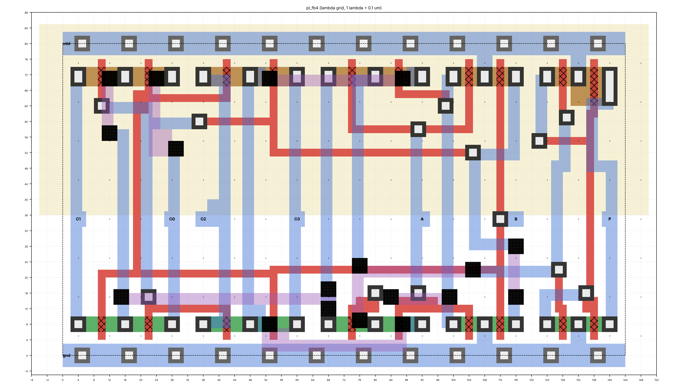
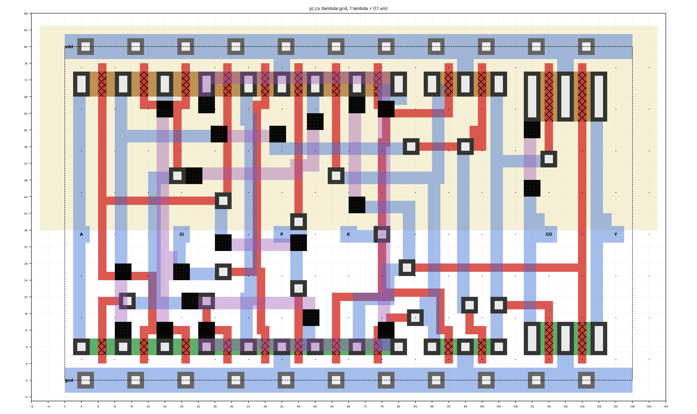

# ALU-specific cells: function block FB4 and carry-sum cell CS

Two cells designed for the bit slice of this ALU. One FB4 and one CS form a complete ALU
bit with 44 transistors; a decoder of ten library cells, shared by all bits, steers them.
Netlists: `fb4_tg20` and `cs_tg24` in `step3_cells/cellnet.py`; library cells `pl_fb4` and
`pl_cs` (`mag/`, `tech/pl018/`). Results below: Ngspice 46, 1.8 V, 27 C, before layout
(`results/ngspice46_2026-11-16/`).

## 1. Function

| Cell | Inputs | Outputs | Function |
| --- | --- | --- | --- |
| FB4 | A, B, C0, C1, C2, C3 | P | P = C0, C1, C2, C3 for (A, B) = 00, 01, 10, 11 |
| CS | P, A, CI, K | CO, Y | CO = CI if P = 1, else A; Y = P if K = 1, else P xor CI |

The four code lines C0..C3 are common to all bits and depend only on the operation, so
P is any function of the operand bits a and b. For the arithmetic operations P is the
propagate signal a xor bx (bx: b, not b, 0 or 1 for ADD, SUB, INC, DEC). When P = 0 the
operands a and bx are equal and the carry out equals a, so the carry needs no generate
signal: CO = P ? CI : A. For the logic operations (K = s2 = 1) the result is P itself.

| Operation (s2 s1 s0) | P | C0 C1 C2 C3 | carry in | K |
| --- | --- | --- | --- | --- |
| ADD 000 | a xor b | 0 1 1 0 | 0 | 0 |
| SUB 001 | a xnor b | 1 0 0 1 | 1 | 0 |
| INC 010 | a | 0 0 1 1 | 1 | 0 |
| DEC 011 | not a | 1 1 0 0 | 0 | 0 |
| AND 100 | a and b | 0 0 0 1 | - | 1 |
| OR 101 | a or b | 0 1 1 1 | - | 1 |
| XOR 110 | a xor b | 0 1 1 0 | - | 1 |
| NOT 111 | not a | 1 1 0 0 | - | 1 |

Decoder (x = s1 xor s0, which is also the carry into bit 0):
C0 = s0 and not (s2 and not s1); C1 = s2 ? (s1 or s0) : not x; C2 = s2 ? x : not s0;
C3 = s2 ? not s1 : x. It is built from one XOR2, two inverters, one NAND2, one AND2, one
NOR2 and three inverting multiplexers of the library. The flags use ten more library
cells; c and v are forced to 0 by s2 for the logic operations.

## 2. Circuits

**FB4, 20 transistors.** Two inverters produce An and Bn. Four transmission gates
controlled by B pass C0 or C1 to node u0 and C2 or C3 to node u1; two transmission gates
controlled by A pass u0 or u1 to node x. Two inverters (x to Pn, Pn to P) restore the
level, so the cell can be used like any static gate. Every path from a code line to x
passes two transmission gates in series.

**CS, 24 transistors.** Inverters for Pn, Kn and CIn. Carry: two transmission gates
controlled by P pass CI or A to node cx, followed by two inverters (cx to COn, COn to
CO); the carry ripples through one transmission gate and two inverters per bit. Result:
two transmission gates controlled by P pass CI or CIn to node xn (xn = P xnor CI), two
transmission gates controlled by K pass xn or Pn to node yn, and one inverter drives Y.

Transmission gates and internal inverters use 0.5k / 0.5kr um (NMOS / PMOS), the output
inverters k / kr um, with the 0.4 um minimum width.

## 3. Sizing and comparison at cell level (Step 3c)

Conditions of the cell sweep (inputs through two X1 inverters, FO4 loads, delay from the
input of the last driver inverter, power including the drivers). The input sequence is
every change of one input in every state of the other inputs (384 transitions for FB4,
64 for CS). All 40 sizes of each cell pass the level checks; the minimum-PDP size is
selected.

| Circuit | T | k | r | Worst delay (ps) | Power (uW) | PDP (fJ) |
| --- | --- | --- | --- | --- | --- | --- |
| **FB4, selected** | 20 | 0.4 | 2.5 | 450.2 | 42.08 | 18.95 |
| FB4, reference size | 20 | 1 | 2 | 437.9 | 50.19 | 21.98 |
| same function: 3 x MUX2I of pl018 | 24 | | | 433.6 | 49.77 | 21.58 |
| same function: 3 x MUX2, static CMOS | 36 | 1 | 2 | 688.7 | 102.77 | 70.78 |
| **CS, selected** | 24 | 0.8 | 1.5 | 458.6 | 73.36 | 33.64 |
| CS, reference size | 24 | 1 | 2 | 439.5 | 85.13 | 37.41 |
| same function: MUX2 + XOR2 + MUX2 of pl018 | 30 | | | 510.0 | 80.54 | 41.08 |
| same function: MUX2 + XOR2 + MUX2, static CMOS | 36 | 1 | 2 | 614.6 | 152.67 | 93.84 |

Against the same function composed of the project's own optimized library cells the
gain of the merged cells is moderate (PDP -12 % and -18 %, transistors -17 % and -20 %);
against static CMOS it is -73 % and -64 %. The larger gain is at ALU level, where the
two cells replace the whole conventional slice.

## 4. Result at ALU level (Step 6)

4-bit ALU, same test for every design (`sim/alutb.py`, 229 transitions, all correct):

| Design | Cells | Transistors | Worst delay (ps) | Energy per operation (fJ) | Leakage (nW) | Energy x delay (fJ ns) |
| --- | --- | --- | --- | --- | --- | --- |
| gate: gate-level cells (NAND-based) | 60 | 842 | 2925.4 | 2039.6 | 1.41 | 5966.7 |
| conv: conventional static CMOS | 60 | 578 | 2979.6 | 3509.8 | 2.02 | 10457.9 |
| opt: minimum-PDP cells, conventional slice | 69 | 402 | 2267.5 | 1102.1 | 0.81 | 2499.1 |
| pl: library pl018, inverting-multiplexer slice | 66 | 458 | 2310.7 | 1312.8 | 0.93 | 3033.6 |
| **fb: FB4 + CS per bit** | 28 | 272 | 2076.2 | 870.6 | 0.47 | 1807.5 |

The function-block ALU against the conventional design: transistors -53 %, worst delay
-30 %, energy per operation -75 %, leakage -76 %. Against the best conventional slice
built from the optimized cells (opt): transistors -32 %, delay -8 %, energy -21 %,
energy x delay -28 %.

## 5. Layout

Both cells are generated by `layout/cellgen.py` from the column plans in
`layout/library.py` and are clean in the generator's rule check and connectivity
extraction; Magic DRC and Netgen LVS in the lab (Step 5) are the sign-off.

| Cell | Size | Sites | Area |
| --- | --- | --- | --- |
| `pl_fb4` | 14.4 x 8.0 um | 18 | 115.2 um2 |
| `pl_cs` | 13.6 x 8.0 um | 17 | 108.8 um2 |

The proposed ALU is placed and routed by Qflow from the hand-mapped netlist
`rtl/alu4_fb_pl018.v` (27 cells) as the fourth design of Step 5.

## 6. Relation to known circuits

* A function block steered by four code lines is the ALU principle of the OM-2 data path
  (Mead and Conway, Introduction to VLSI Systems, 1980), there in nMOS pass-transistor
  logic with separate propagate, kill and result blocks and a precharged carry chain.
* A carry multiplexer steered by the propagate signal, with an operand as its second
  input, followed by an XOR for the sum, is the carry logic of FPGA logic cells.
* What this project adds: the two ideas combined into two restoring transmission-gate
  standard cells with a single function block per bit, usable in a static CMOS cell
  flow; their sizing and layout in 180 nm; and the measured comparison with conventional
  cell-based implementations of the same ALU, before and after layout.

The paper must cite these sources and must not claim the function block or the carry
multiplexer as new circuits. A literature search for transmission-gate function-block
ALU cells in recent work is still to be done.

## 7. Open points

* Lab verification of `pl_fb4` and `pl_cs` (Magic DRC, Netgen LVS, extraction) and
  characterization from the extracted layouts.
* Post-layout numbers of the placed-and-routed proposed ALU (Step 5, design `fb`).
* The carry path has two inverters per bit; a version with alternating carry polarity
  would save one inverter delay per bit at the cost of a second cell variant.
* Supply, temperature and Monte Carlo analysis of the transmission-gate paths.
